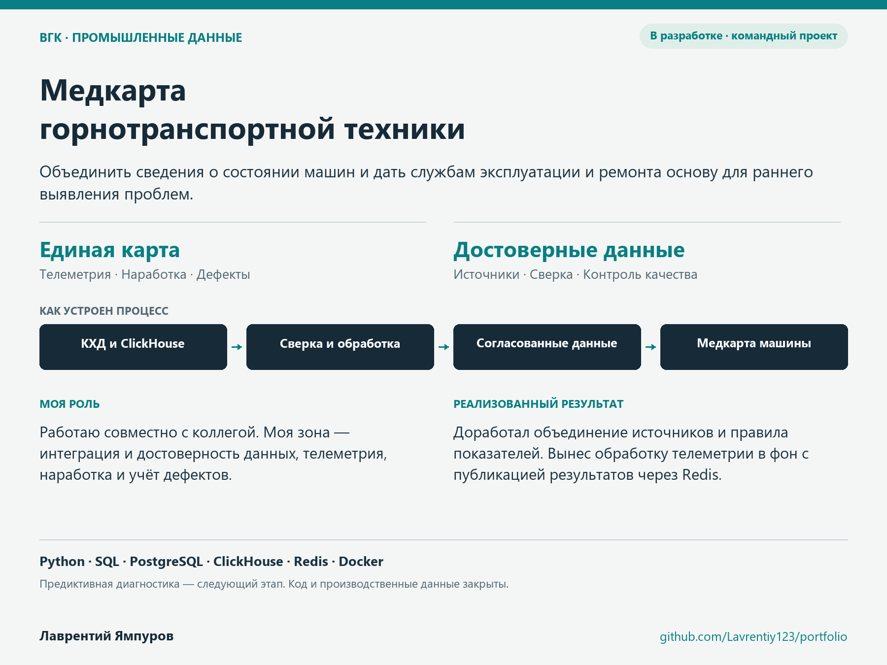
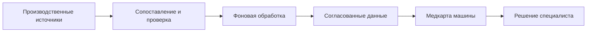

# Медкарта горнотранспортного оборудования — ВГК

## Задача

Создать систему мониторинга технического состояния и поддержки обслуживания горнотранспортного оборудования для производственных служб ВГК. Система должна объединять разрозненные сведения в единую медкарту машины и давать специалистам основу для раннего выявления проблем и планирования обслуживания.

Предметный контур включает телеметрию, наработку, дефекты, лабораторные сведения, условия эксплуатации и ремонтный контекст. Развитие предиктивной диагностики — следующий этап проекта.

## Моя роль

Совместно с коллегой разрабатываю продукт. Моя основная зона ответственности — интеграция и достоверность производственных данных, телеметрия, наработка и учёт дефектов. Прорабатываю требования и пригодность данных с профильными специалистами, разрабатываю свою часть и проверяю её в общем приложении.

## Результат

**На уровне команды:** создан веб-продукт с карточками оборудования и блоками технического состояния. Медкарта и её общий выпуск являются совместным результатом.

**Мой вклад:**

- Объединение и сверка данных корпоративного хранилища и ClickHouse, посменная проверка счётчиков и контроль происхождения показателей.
- Сопоставление машин и агрегатов с сохранением неоднозначностей исходных связей.
- Правила представления состояния с учётом пропусков, ошибок измерений и оснований оценки.
- Фоновая обработка телеметрии и публикация согласованных результатов через Redis.
- Проверка своей части в общем приложении и доработка по результатам проверок.

На текущем этапе реализован программный контур медкарты и механизмы работы с производственными данными. Проект продолжается; достигнутая точность прогнозирования отказов и экономический эффект не заявляются.

## Статус

Проект продолжается: разработка, проверка и доработка решения совместно с коллегой. Завершённый продукт пока не заявляется. Предиктивные модели — направление развития; точность предупреждения отказов и экономический эффект не заявляются.

## Технологии

Стек моей части: Python, SQL, PostgreSQL, ClickHouse, Redis, Docker.

## Возможности исходного продукта

- Карточка машины с телеметрией, наработкой, дефектами, лабораторными сведениями и ремонтным контекстом.
- Объединение корпоративного хранилища и ClickHouse, сверка счётчиков и происхождения показателей.
- Различение отсутствующих данных, некорректного измерения и нормального состояния.
- Фоновая обработка телеметрии и публикация согласованных результатов через Redis.
- Работа со связями машины и агрегатов с сохранением неоднозначностей привязки.

## Архитектура и технические решения

Производственные источники проходят сопоставление и проверку в интеграционном слое. Согласованные результаты фоновых расчётов публикуются через Redis; интерфейс получает показатели вместе с их происхождением и признаками пригодности.

Схема показывает общий процесс без внутренних адресов, корпоративных правил и исходного кода.

## Публичные материалы

Здесь опубликовано описание исходного продукта: задача, возможности, мой вклад и технические решения. Исходный код, внутренние инструкции, корпоративные документы, данные и настройки не публикуются. Отдельной демонстрационной программы в портфолио нет.

[Все проекты](../README.md)
