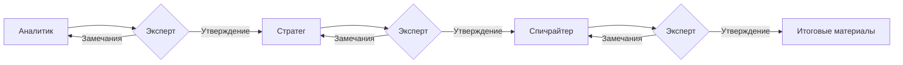

# Конвейер стратегической аналитики — Газпром нефть

## Задача

Связать исследование рынка и конкурентов, подготовку стратегических альтернатив и материалы для руководства в единый процесс с экспертной проверкой между этапами.

## Моя роль

Самостоятельно спроектировал и разработал программную платформу по бизнес-требованиям и методологии заказчика. В проекте также участвовал практикант — бизнес-аналитик. Исходную трёхролевую схему и корпоративную методологию предоставил заказчик.

## Результат

Создал веб-приложение с ролями Аналитика, Стратега и Спичрайтера и 19 видами заданий. Реализовал передачу контекста, экспертное утверждение и возврат с замечаниями, связанные версии результатов, загрузку PDF/DOCX и экспорт Word/Markdown. Пользователь получает аналитический материал, проверяет его и передаёт на следующий этап. Продукт защитил перед руководителем и передал заказчику; решение используется в компании.

## Статус

Готовый продукт. Защищён перед руководителем, передан заказчику и используется в Газпром нефти. Продолжаю небольшие доработки и сопровождение. Измеренный экономический эффект и экономия времени отдельно не заявляются.

## Технологии

Python, FastAPI, SQLite, JavaScript, Anthropic SDK, Markdown/YAML.

## Возможности исходного продукта

- Три специализированные роли: Аналитик, Стратег и Спичрайтер.
- Каталог из 19 заданий, отдельные запуски и последовательный конвейер.
- Передача утверждённого материала следующей роли.
- Экспертное утверждение либо возврат с замечаниями и создание связанной версии.
- История запусков, результатов и документов.
- PDF/DOCX на входе, экспорт Word/Markdown, отображение хода выполнения и расчётной стоимости.

| Роль | Задания |
|---|---|
| Аналитик — 6 | Справка по конкуренту, отраслевой обзор, события за неделю, дайджест, карта стратегий, ранние сигналы |
| Стратег — 5 | Диагностика портфеля, стратегические опции, сценарии, проект стратегии, реестр допущений |
| Спичрайтер — 8 | Структура презентации, выступление, Q&A, резюме для руководства, ценностное предложение, коммуникационный план, сценарии сессий, проверка согласованности |

## Пользовательский процесс

Пользователь выбирает задание или последовательный процесс, задаёт параметры и входные материалы. Результат останавливается на экспертной проверке. После утверждения он становится входом следующего этапа; замечания используются при создании связанной версии.

## Архитектура и технические решения

Python/FastAPI обслуживает приложение; SQLite хранит запуски, статусы и версии; JavaScript обеспечивает интерфейс. Описания заданий отделены от механизма выполнения. Интеграция Anthropic SDK используется для генерации, а обработка документов связывает входные материалы с результатами и экспортом.

Трёхролевую схему и методологическую основу предоставил заказчик. Мой вклад — самостоятельная программная реализация процесса. Задание проверки согласованности выполняется моделью и не является независимой гарантией правильности. Подтверждённый экспорт текущей платформы — Word/Markdown; структура презентации не означает автоматическую сборку PPTX.

## Публичные материалы

Здесь опубликовано описание исходного продукта: задача, возможности, мой вклад и технические решения. Исходный код, внутренние инструкции, корпоративные документы, данные и настройки не публикуются. Отдельной демонстрационной программы в портфолио нет.

[Все проекты](../README.md)
