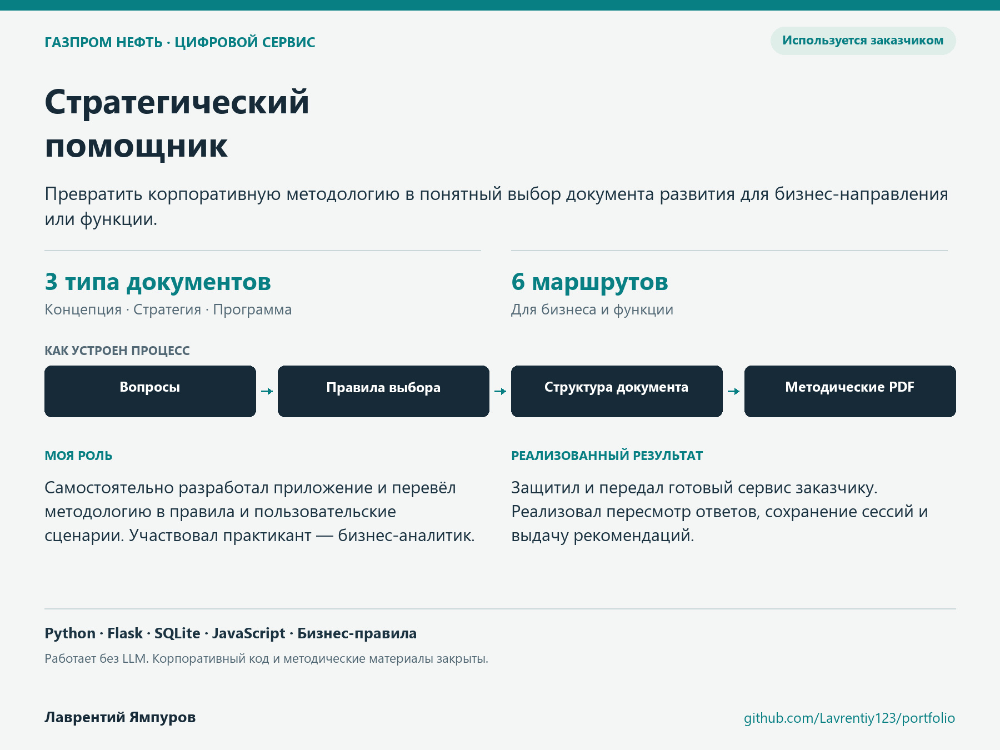

# G2 — помощник выбора стратегического документа

## Задача

Перевести корпоративную методологию в понятный маршрут выбора документа развития: концепции, стратегии или программы для бизнес-направления либо функции.

## Моя роль

Самостоятельная разработка приложения и перевод методологии в правила и пользовательские сценарии. Со мной в проекте участвовал практикант — бизнес-аналитик.

## Результат

Разработал пошаговый интерфейс с шестью деревьями выбора, проверкой ответов, возвратом по шагам, выдачей PDF-рекомендаций и глоссария. Логика выбора следует явным правилам; результат можно проследить до ответов пользователя. Продукт защитил перед руководителем и передал заказчику; решение используется в компании.

## Статус

Готовый продукт. Защищён перед руководителем, передан заказчику и используется в Газпром нефти. Продолжаю небольшие доработки и сопровождение. Измеренный экономический эффект и экономия времени отдельно не заявляются.

## Технологии

Python, Flask, Waitress, SQLite, JavaScript.

## Возможности исходного продукта

- Пошаговая диагностика задачи по явным правилам, без LLM.
- Выбор концепции, стратегии или программы для бизнеса либо функции — шесть деревьев выбора.
- Рекомендации по структуре, особенностям и характеристикам документа.
- Выдача подготовленных PDF-рекомендаций и глоссария.
- Сессии SQLite, история ответов, возврат, экспорт/импорт и контроль одновременных изменений.

## Пользовательский процесс

Пользователь отвечает на вопросы, получает рекомендуемый тип документа, уточняет область применения и изучает структуру. Затем скачивает подготовленные материалы. Возврат к ответу позволяет пересмотреть маршрут; история хранится в сессии.

## Архитектура и технические решения

Python/Flask обслуживает пользовательские действия; JavaScript отображает диалог; SQLite хранит состояние и историю. Правила отделены от интерфейса. Контроль владельца сессии и ожидаемой версии защищает историю от незаметного перезаписывания при параллельных действиях. Для локального запуска используется Waitress.

Методологическую основу предоставил заказчик. Мой вклад — перевод требований в приложение, интерфейс, правила переходов и работу с сессиями. PDF являются подготовленными методическими материалами, а не ответом языковой модели.

## Публичные материалы

Здесь опубликовано описание исходного продукта: задача, возможности, мой вклад и технические решения. Исходный код, внутренние инструкции, корпоративные документы, данные и настройки не публикуются. Отдельной демонстрационной программы в портфолио нет.

[Все проекты](../README.md)
