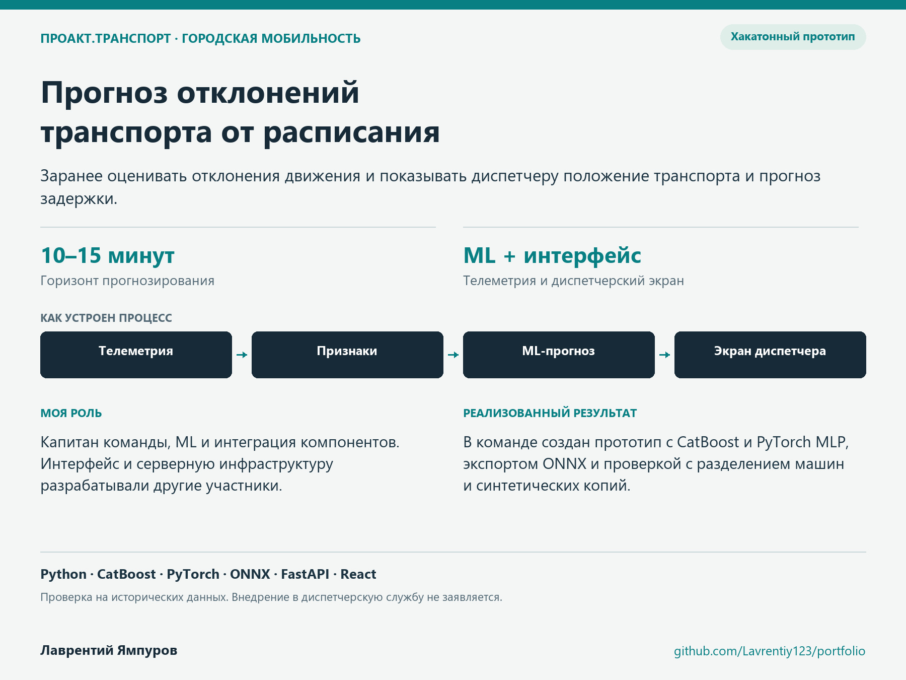

# ПроАкт.Транспорт — прогноз отклонения транспорта от расписания

## Задача

Заранее оценивать отклонение транспорта от расписания и показывать диспетчеру положение машин, прогноз и возможные причины задержки.

## Моя роль

Капитан команды, ML и интеграция компонентов. Серверную инфраструктуру и интерфейс разрабатывали другие участники команды.

## Результат

Участвовал в создании решения с обработкой телеметрии, прогнозом на горизонт 10–15 минут и диспетчерским интерфейсом. В ML-контуре используются CatBoost и PyTorch MLP с экспортом в ONNX; валидация разделяет борта и их синтетические копии для контроля утечек.

## Статус

Командный хакатонный прототип. Демонстрация воспроизводит исторический день; она не означает внедрение в диспетчерскую службу. Экономический эффект требует проверки на эксплуатации.

## Технологии

Python, CatBoost, PyTorch, ONNX, FastAPI, React, MapLibre, Docker.

## Возможности и использование

Диспетчерский интерфейс показывает положение транспорта, отклонение от расписания и прогноз на горизонт 10–15 минут. Телеметрия используется для формирования признаков и обновления оценок. Сценарий проверки воспроизводит исторические данные организаторов; работа реального диспетчерского парка в эксплуатации не заявляется.

## Архитектура и технические решения

Обработка телеметрии связана с общим контуром признаков и ML-прогнозом. Для прогнозирования используются CatBoost и PyTorch MLP с экспортом в ONNX. Серверный слой и диспетчерский интерфейс связывают прогноз с отображением транспорта. При оценке качества борта и их синтетические копии разделяются совместно, чтобы не получить утечку между обучением и проверкой.

Я отвечал за ML и интеграцию как капитан команды; серверную инфраструктуру и интерфейс разрабатывали другие участники.

## Исходный код и материалы

[proact-transport](https://github.com/Lavrentiy123/proact-transport)

Опубликован командный хакатонный прототип. Промышленное внедрение не заявляется.

[Все проекты](../README.md)
