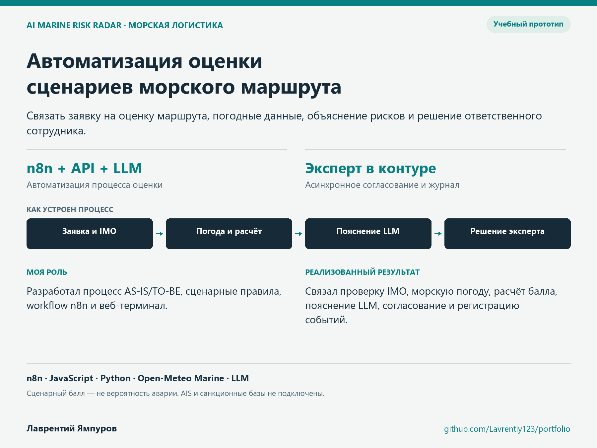

# AI Marine Risk Radar — автоматизация оценки сценариев морской логистики

## Задача

Организовать путь от заявки на оценку маршрута до объяснения рисков, решения ответственного сотрудника и регистрации результата.

## Моя роль

Разработал учебный прототип процесса: описание AS-IS/TO-BE, логику оценки, автоматизацию на n8n и веб-терминал.

## Результат

Реализовал проверку IMO, получение морской погоды, расчёт сценарного балла по явным правилам, пояснение с помощью LLM, журнал событий и асинхронное согласование. Балл используется для сравнения сценариев и не является вероятностью происшествия.

## Статус

Учебный прототип. AIS, санкционные базы, тарифы и страховые данные не подключены; действующий публичный стенд не подтверждён.

## Технологии

n8n, JavaScript, Python, Open-Meteo Marine, LLM, Data Tables.

## Возможности и использование

1. Пользователь задаёт судно и параметры сценария через веб-терминал.
2. Прототип проверяет входные данные, включая IMO.
3. Получает морские погодные данные Open-Meteo Marine.
4. Рассчитывает сценарный балл по явным правилам.
5. LLM формирует пояснение, а ответственный сотрудник согласует результат.
6. События и решение фиксируются в журнале.

## Архитектура и технические решения

Веб-терминал служит точкой ввода, n8n связывает этапы обработки и согласования, JavaScript реализует расчётную логику. Числовой балл отделён от пояснения языковой модели. Для журнала используются Data Tables. Процесс описан через AS-IS/TO-BE и точки автоматизации.

Сценарный балл не является вероятностью аварии. AIS, санкционные, тарифные и страховые источники не подключены; журнал не заявляется как неизменяемое хранилище. Это границы самого прототипа, а не скрытые функции закрытой версии.

## Публичные материалы

Опубликовано описание процесса и реализованных возможностей. Workflow n8n и веб-терминал в публичное портфолио не включены.

[Все проекты](../README.md)
